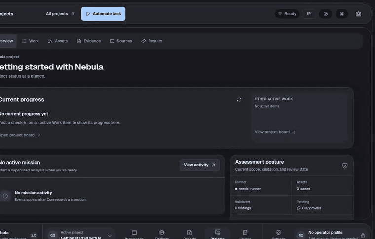

<div align="center">
  <h1>Nebula</h1>
  <p>Cybersecurity harness built around the operator</p>
</div>

Nebula is a cybersecurity harness built around the operator. Test manually in its browser and Kali terminal, or let agents code and test autonomously in Assistant or Missions. Set project scope, tools, and approvals, then preserve evidence, develop findings, and produce reports.

## Start with the Nebula assistant

Click the bot icon in the upper-right corner to ask how Nebula works, get help with setup, or find your way around. The dedicated Nebula assistant can open pages and settings for you, including Model providers, Terminal, and Files. Connect a model or harness for conversational answers.



[Watch the walkthrough video](docs/videos/nebula-assistant-getting-started.mp4).

## Acknowledgement

First, I would like to thank Almighty God, who is the source of all knowledge. Without Him, this would not be possible.

> Use Nebula only on systems and networks you own or are explicitly authorized to test.

## Operator control

Choose scope, tool access, approvals, execution mode, and mission budgets. Nebula applies the configured scope and approval policy to its managed tools; the explicit **Allow all** option bypasses those checks. You can monitor and stop runs, and steer supported harness turns.

Upload an OpenVPN profile to route project container commands and Kali terminal traffic through a VPN. Host mode uses the host's network; container VPN routing does not apply there.

[Mercury](https://github.com/berylliumsec/mercury) is optional. When Nebula Core and its agent processes are enrolled under Mercury, Mercury can add independent file, process, and network controls. Nebula does not automatically enroll a separately started Core service.

## Choose your runtime

Bring Codex or Grok as external harnesses, or run Nebula's agent with Anthropic's Claude, OpenRouter, or a local model served by Ollama or vLLM. On supported routes, Nebula uses prompt caching and shows the cache reads providers report. Hit rates vary by model and workload.

## Install the preview

The current preview targets Linux x86_64. Follow the [signed APT installation guide](https://berylliumsec.github.io/nebula-apt/) or download a DEB or AppImage from [GitHub Releases](https://github.com/BerylliumSec/nebula/releases). Check the release notes and back up engagement data before upgrading.

Docker or Podman is needed for the Kali terminal and Docker-mode automation. Host-mode agent commands run directly on the Nebula host without a container runtime after you acknowledge host filesystem and network access. Kali image preparation may take several minutes. A source checkout may contain features ahead of the published preview.

## Run from source

Install Python 3.11–3.13, Poetry 2.1.3, Node.js 20 with npm, Rust, and the [Tauri prerequisites](https://v2.tauri.app/start/prerequisites/), then run:

```console
git clone https://github.com/BerylliumSec/nebula.git
cd nebula
poetry install --with dev
poetry run playwright install chromium
npm --prefix ui ci
npm --prefix ui run dev:desktop
```

For Core administration, browser-only development, and diagnostics, see the [Nebula 3 guide](docs/NEBULA3.md).

## Read more

- [Usage scenarios](docs/NEBULA3_USAGE_SCENARIOS.md)
- [Automation runtime](docs/AUTOMATION-RUNTIME.md)
- [Local diagnostics](docs/NEBULA3_DIAGNOSTICS.md)
- [Release notes](docs/releases/)
