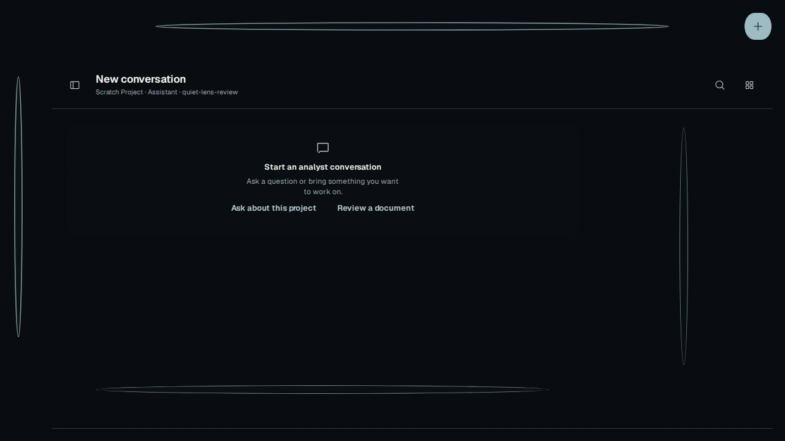
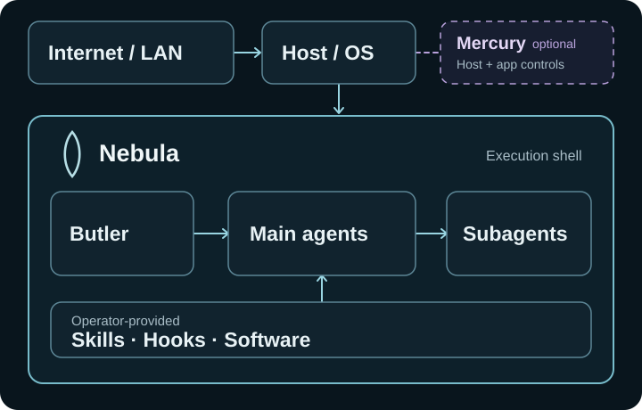

<div align="center">
  
  <h1>Nebula</h1>
  <p>Cybersecurity harness built around the operator</p>
</div>



## Acknowledgement

First, I would like to thank Almighty God, who is the source of all knowledge. Without Him, this would not be possible.

> Use Nebula only on systems and networks you own or are explicitly authorized to test.

## Key features

- **One Project for the engagement.** Keep assets, browser sessions, Kali terminals, code, files, notes, findings, and reports together.
- **Security browser and interception.** Capture in-scope traffic in the desktop browser, intercept and edit requests, and use Repeater and Intruder for follow-up testing.
- **Bring your own skills.** Add `SKILL.md` skills to a Project and select them in chat for assistant work.
- **Kali tools and optional VPN egress.** Run container commands with Docker or Podman and route authorized container traffic through a Project-selected OpenVPN profile.
- **Operator-controlled automation.** Set scope, approvals, and budgets for assistant and mission actions.
- **Evidence through reporting.** Preserve hashed artifacts and execution provenance, link evidence to findings, and export reports or engagement bundles.

## Butler


**Not sure how to get started? Ask Butler.** Select the Nebula logo in the header or mobile navigation, then chat or start Voice.

With a configured model or harness, Butler can answer questions, review the selected project's chats and goals, start or steer work, and manage settings and approvals. It shows delegated work separately from main agents; to redirect a child, ask Butler to guide its parent agent.

**Voice setup:** GPT-Live requires a direct OpenAI API key. Add an enabled OpenAI provider with a key in Nebula Settings, or set `OPENAI_API_KEY` on the Nebula host. Nebula keeps the key on the host to start the voice session; your device then exchanges audio with OpenAI over WebRTC. Voice sessions incur OpenAI API charges. Butler can delegate work to a Codex harness, but Codex access does not provide the GPT-Live key. See [OpenAI's GPT-Live WebRTC setup](https://developers.openai.com/api/docs/guides/voice-webrtc#before-you-start).

Voice pauses after 20 seconds of quiet by default; change this Core-wide timeout in Butler settings. Pausing ends the paid GPT-Live session, and **Resume Voice** starts a new one. Butler work already submitted continues in its saved chat.

<picture>
  <source media="(prefers-reduced-motion: reduce)" srcset="docs/images/butler-voice-sample.png">
  
</picture>

<p><sub>Illustrative sample project. This GIF is silent; Butler speaks in an active Voice session.</sub></p>

When a goal starts, Butler watches its supported progress events even if the panel is closed. The project can grant Watch, Steer, or specific Delegate actions. GPT-Live listens and speaks in Voice mode; the Core Butler runs the tools, owns the saved conversation and context compaction, and continues oversight while Voice is off. Voice does not yet speak unsolicited alerts. Separately, Butler checks relevant precedent before acting and keeps durable, selective memory of useful preferences, decisions, and lessons across projects. Open Memory in the Butler panel whenever you want to review, edit, or delete an entry.

A fresh Core data directory starts with empty Butler memory. Its SQLite records stay in that data directory across app updates, and the Chroma search index can be rebuilt from them.

<p align="center">
  
</p>

## Work

Use Codex or Grok as harnesses, or connect Claude, OpenRouter, Ollama, or vLLM. Docker or Podman powers Kali and container-mode automation; Host mode uses the host's filesystem and network after explicit acknowledgement. Optional OpenVPN routes container traffic, while [Mercury](https://github.com/berylliumsec/mercury) can add independent controls when enrolled.

## Install

The Linux x86_64 preview is available through the [signed APT repository](https://berylliumsec.github.io/nebula-apt/) or as a [DEB or AppImage](https://github.com/BerylliumSec/nebula/releases). Back up engagement data before upgrading.

## From source

Install Python 3.11–3.13, Poetry 2.1.3, Node.js 20 with npm, Rust, and the [Tauri prerequisites](https://v2.tauri.app/start/prerequisites/), then run:

```console
git clone https://github.com/BerylliumSec/nebula.git
cd nebula
poetry install --with dev
poetry run playwright install chromium
npm --prefix ui ci
npm --prefix ui run dev:desktop
```

## Documentation

Start with the [Nebula 3 guide](docs/NEBULA3.md) or [usage scenarios](docs/NEBULA3_USAGE_SCENARIOS.md). The [documentation index](docs/README.md) groups setup, integrations, troubleshooting, technical reference, and release information.
