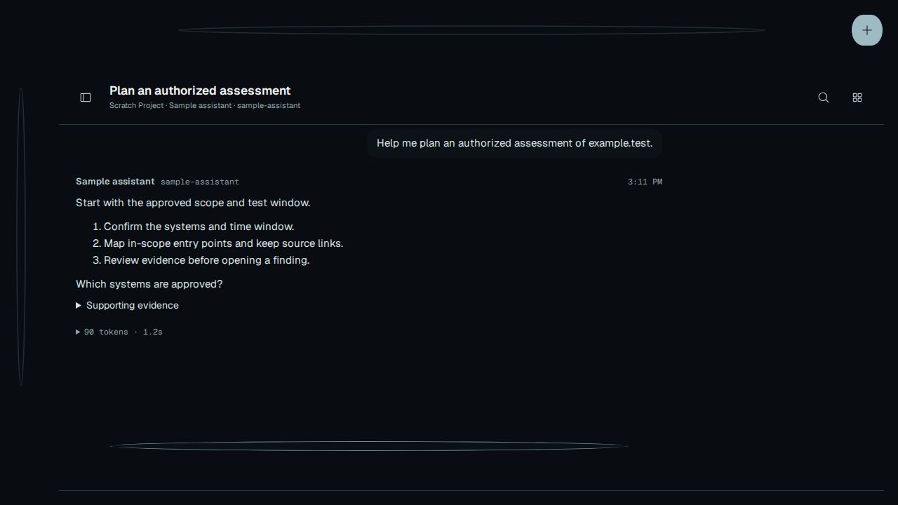

<div align="center">
  <h1>Nebula</h1>
  <p>Cybersecurity harness built around the operator</p>
</div>

Investigate in a browser and Kali terminal, or direct agents within a scoped project. Set approvals, preserve evidence, and turn findings into reports.



## Acknowledgement

First, I would like to thank Almighty God, who is the source of all knowledge. Without Him, this would not be possible.

> Use Nebula only on systems and networks you own or are explicitly authorized to test.

## Nebula assistant


Find the bot icon in Nebula's upper-right corner. It helps you find and open settings or pages; with a connected model or harness, you can ask questions about Nebula and troubleshoot setup or workflow issues.

## Work

Set project scope, tool access, approvals, execution mode, and mission budgets. Monitor, steer, or stop supported runs. The explicit **Allow all** setting bypasses Nebula's managed-tool checks.

Use Codex or Grok as harnesses, or connect Claude, OpenRouter, Ollama, or vLLM. Docker or Podman powers Kali and container-mode automation; Host mode uses the host's filesystem and network after explicit acknowledgement. Optional OpenVPN routes container traffic, while [Mercury](https://github.com/berylliumsec/mercury) can add independent controls when enrolled.

## Install

The Linux x86_64 preview is available through the [signed APT repository](https://berylliumsec.github.io/nebula-apt/) or as a [DEB or AppImage](https://github.com/BerylliumSec/nebula/releases). Back up engagement data before upgrading.

## From source

Install Python 3.11–3.13, Poetry 2.1.3, Node.js 20 with npm, Rust, and the [Tauri prerequisites](https://v2.tauri.app/start/prerequisites/), then run:

```console
git clone https://github.com/BerylliumSec/nebula.git
cd nebula
poetry install --with dev
poetry run playwright install chromium
npm --prefix ui ci
npm --prefix ui run dev:desktop
```

## More

[Nebula 3 guide](docs/NEBULA3.md) · [Usage scenarios](docs/NEBULA3_USAGE_SCENARIOS.md) · [Automation runtime](docs/AUTOMATION-RUNTIME.md) · [Diagnostics](docs/NEBULA3_DIAGNOSTICS.md) · [Release notes](docs/releases/)
