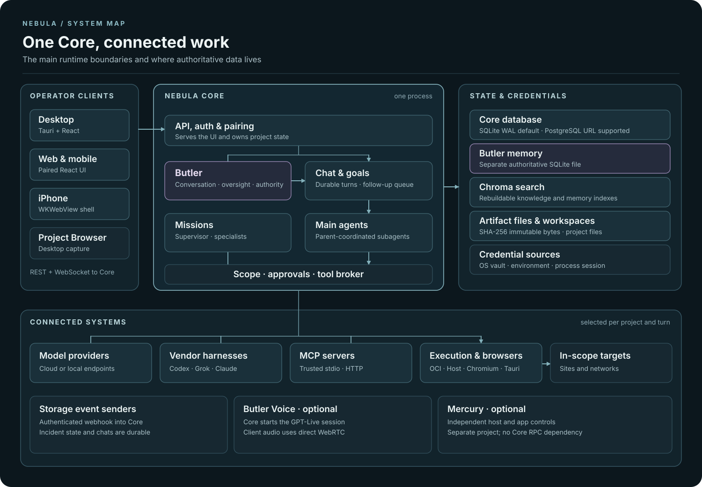

# Nebula system architecture

This source-level map shows Nebula 3's major runtime boundaries and available
connections. Optional paths appear even when they are disabled in a particular
installation.

[Open the full-size SVG](images/nebula-system-architecture.svg).

## Reading the map

- **Core has one control plane with separate runtime processes.** A stable
  supervisor owns ingress and replaceable API workers. Each admitted project
  has an execution worker for its chats, goals, missions and tools; this is not
  one worker per assistant. Workers are admitted on demand. Butler can guide a
  main agent through Core; the parent coordinates its subagents.
- **The stores have different roles.** The Core SQL database holds durable
  records, while Butler memory has a separate authoritative SQLite file.
  Artifact files hold immutable bytes, project workspaces hold working files,
  and Chroma holds rebuildable search indexes. Core resolves credentials from
  the host's vault, environment, or process session.
- **Execution leaves Core through selected boundaries.** Provider requests,
  vendor harnesses, and MCP servers use configured endpoints. Docker or Podman
  runs container work; Host mode requires explicit authorization. The desktop
  Project Browser and Core-managed Chromium are distinct paths to targets.
  Container egress may use optional OpenVPN.
- **Other paths are conditional.** Storage senders post authenticated events
  into Core. Butler Voice uses Core for session setup and direct client-to-OpenAI
  WebRTC audio. Mercury is a separate optional control project, not a Core RPC.

## Source map

| Boundary | Implementation and contract |
| --- | --- |
| Clients and Core API | [Tauri Core connection](../ui/src-tauri/src/core_connection.rs), [iPhone shell](../ios/README.md), [Core API](../src/nebula/v3/api.py) |
| Butler and agent coordination | [Butler oversight](../src/nebula/v3/butler_oversight.py), [authority](../src/nebula/v3/butler_authority.py), [work actions](../src/nebula/v3/control_assistant_work.py), [subagents](../src/nebula/v3/chat_subagents.py) |
| Provider, harness, and mission paths | [Chat](../src/nebula/v3/chat.py), [providers](../src/nebula/v3/providers.py), [harnesses](../src/nebula/v3/harnesses.py), [missions](../src/nebula/v3/missions.py) |
| Tool and browser boundaries | [Automation runtime](../src/nebula/v3/automation_runtime.py), [container runner](../src/nebula/v3/sandbox.py), [MCP](../src/nebula/v3/mcp.py), [managed browser](../src/nebula/v3/browser_host.py), [desktop browser proxy](../ui/src-tauri/src/browser_proxy.rs), [Project Browser contract](SECURITY-BROWSER-CONTRACT.md) |
| Authoritative and derived state | [Core data setup](../src/nebula/v3/cli.py), [SQL database](../src/nebula/v3/database.py), [Butler memory](../src/nebula/v3/butler_memory.py), [artifacts](../src/nebula/v3/artifacts.py), [workspaces](../src/nebula/v3/workspace.py), [Chroma index](../src/nebula/v3/knowledge_index.py), [credentials](../src/nebula/v3/credentials.py) |
| Knowledge, evidence, and reports | [Knowledge](../src/nebula/v3/knowledge.py), [evidence](../src/nebula/v3/evidence.py), [reporting](../src/nebula/v3/reporting.py) |
| Optional integrations | [Storage event contract](storage-integrations.md), [voice session](../src/nebula/v3/live_voice.py), [Nebula overview](../README.md) |

## Automatic project runtime recovery

The supervisor checks expired project owners independently of API health. An
expired lease alone is not proof of process death: recovery requires the exact
original process incarnation to be absent in its verified launch namespace.
Live, unreachable or uncomparable processes retain their authority and resources.

For a positively dead owner, Core records interrupted provider responses, clears
their stale claims, parks provider admissions and commits stream-end markers.
Provider/background capacity is released only for the exact dead incarnation
and provider admission token; tool and CPU reservations retain their own evidence.
Already paused or blocked goals retain their holds. Unknown tool or hook effects
remain in their original ledgers and require operator review; recovery never
declares those effects successful or automatically replays them. Other pinned
resources, uncertain durable commands and unconfirmed approvals continue to hold
admission until their own outcomes are reconciled.

Durable, source-fence-specific deployment operations prepare a replacement of the
same execution version and transfer ownership through checkpoint restoration and
verification. Lost operation responses do not authorize another process launch.
The host retains recovery receipts across restarts, applies diagnostic backoff,
and holds projects after three recoveries in ten minutes rather than crash-looping.
Checkpoint hashing has no total-record ceiling: entity, provider admission and
tool-manifest references stream in batches of 10,000 from one SQL statement
snapshot. The compact v1 digest remains unchanged, including optional manifest
inventories. Large projects do not require loading all records into Core memory.
Host/API health can remain healthy while a project is recovering or needs review;
read deployment status and saved recovery evidence before claiming success.
