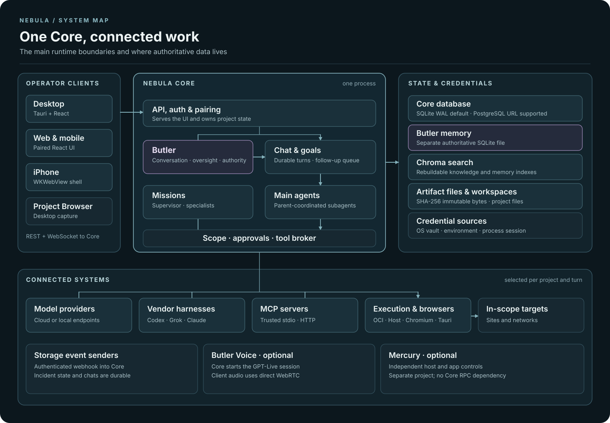

# Nebula system architecture

This source-level map shows Nebula 3's major runtime boundaries and available
connections. Optional paths appear even when they are disabled in a particular
installation.

[Open the full-size SVG](images/nebula-system-architecture.svg).

## Reading the map

- **Core is one process.** Its API, Butler, chat and goal services, mission
  supervisor, and tool broker share the same control plane. Butler can guide a
  main agent through Core; the parent coordinates its subagents.
- **The stores have different roles.** The Core SQL database holds durable
  records, while Butler memory has a separate authoritative SQLite file.
  Artifact files hold immutable bytes, project workspaces hold working files,
  and Chroma holds rebuildable search indexes. Core resolves credentials from
  the host's vault, environment, or process session.
- **Execution leaves Core through selected boundaries.** Provider requests,
  vendor harnesses, and MCP servers use configured endpoints. Docker or Podman
  runs container work; Host mode requires explicit authorization. The desktop
  Project Browser and Core-managed Chromium are distinct paths to targets.
  Container egress may use optional OpenVPN.
- **Other paths are conditional.** Storage senders post authenticated events
  into Core. Butler Voice uses Core for session setup and direct client-to-OpenAI
  WebRTC audio. Mercury is a separate optional control project, not a Core RPC.

## Source map

| Boundary | Implementation and contract |
| --- | --- |
| Clients and Core API | [Tauri Core connection](../ui/src-tauri/src/core_connection.rs), [iPhone shell](../ios/README.md), [Core API](../src/nebula/v3/api.py) |
| Butler and agent coordination | [Butler oversight](../src/nebula/v3/butler_oversight.py), [authority](../src/nebula/v3/butler_authority.py), [work actions](../src/nebula/v3/control_assistant_work.py), [subagents](../src/nebula/v3/chat_subagents.py) |
| Provider, harness, and mission paths | [Chat](../src/nebula/v3/chat.py), [providers](../src/nebula/v3/providers.py), [harnesses](../src/nebula/v3/harnesses.py), [missions](../src/nebula/v3/missions.py) |
| Tool and browser boundaries | [Automation runtime](../src/nebula/v3/automation_runtime.py), [container runner](../src/nebula/v3/sandbox.py), [MCP](../src/nebula/v3/mcp.py), [managed browser](../src/nebula/v3/browser_host.py), [desktop browser proxy](../ui/src-tauri/src/browser_proxy.rs), [Project Browser contract](SECURITY-BROWSER-CONTRACT.md) |
| Authoritative and derived state | [Core data setup](../src/nebula/v3/cli.py), [SQL database](../src/nebula/v3/database.py), [Butler memory](../src/nebula/v3/butler_memory.py), [artifacts](../src/nebula/v3/artifacts.py), [workspaces](../src/nebula/v3/workspace.py), [Chroma index](../src/nebula/v3/knowledge_index.py), [credentials](../src/nebula/v3/credentials.py) |
| Knowledge, evidence, and reports | [Knowledge](../src/nebula/v3/knowledge.py), [evidence](../src/nebula/v3/evidence.py), [reporting](../src/nebula/v3/reporting.py) |
| Optional integrations | [Storage event contract](storage-integrations.md), [voice session](../src/nebula/v3/live_voice.py), [Nebula overview](../README.md) |
