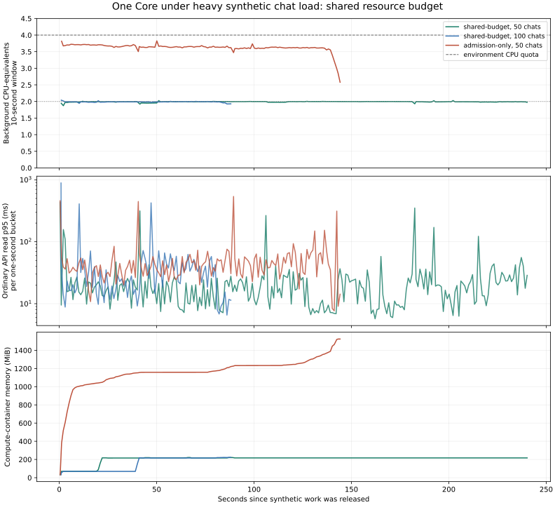

# Fifty-chat resource-budget model

This continues `experiment/core-process-workers`. It models a shared background
compute budget under heavy synthetic load; it does not activate a production
scheduler or deploy Core. One authenticated Core owns all durable state. An owned
Docker compute container supplies enforceable aggregate CPU, memory and PID limits
for both pure PDF rendering and inert CPU jobs representing external tool work.

## Contract recorded before implementation

| Journey | Observable invariant | Authority | Evidence |
| --- | --- | --- | --- |
| Start 50 chats | Fifty distinct durable chats enter their real harness turns before the load barrier opens | Core chat/harness state and current host admission | Authenticated LAN API, barrier and saved statuses |
| Sustain load | Chats repeatedly request CPU work while PDF rendering and ordinary reads continue | Core state; disposable compute container | Per-second CPU/RSS, HTTP latency, loop lag and completed work |
| Bound background work | Protected compute shares two CPUs, a memory limit, a PID limit and bounded count/bytes across all chats and reports | Kernel cgroup plus model scheduler | Actual `cpu.max`, memory/PID counters, queue maxima |
| Fair sharing | One chat cannot consume every execution slot or grow its pending work without a bound | Model scheduler | Noisy-neighbor dispatch trace and deterministic boundary checks |
| Interrupt | Cancelled queued jobs never execute; running cancellations retain reservations until compute finishes | Model scheduler and Core turn state | Held-job checks and real chat cancellation |
| Overload/recover | Excess jobs fail explicitly; accepted jobs drain and capacity returns | Scheduler/Core receipts | Burst, recovery probe and final zero reservations |
| Memory failure | A deliberately oversized owned compute job is contained; Core remains reachable; later explicit work can recover | Kernel cgroup and disposable executor lifecycle | OOM counter, authenticated reads and explicit executor reset |
| Refresh/replay | Saved tool identity and ordered event cursors survive fresh reads | Core database | Exact tool pairs and replay checks |
| Shutdown | Only owned Core/container resources are stopped and temporary data removed | Driver ownership | Exit/cleanup receipt |

Compare admission-only behavior (a two-render limit with independent tool jobs)
with a proposed shared, fair budget. Both use the same synthetic work. Record
pre-existing host load and avoid substituting fabricated host-pressure values.
The measured cases, selected checks and their limitations are recorded below.

## Environment and workload

The executor provides four CPU-equivalents (`cpu.max=400000 100000`), five
affinity CPUs and 16 GiB of memory. A preliminary owned container with
`cpu.max=50000 100000` performed 0.500 CPU-seconds in 1.003 wall-seconds and
recorded kernel throttling. Docker limits are enforced here, despite the outer
executor's cgroup directory being unwritable by the task user.

The protected model uses one networkless compute container with two CPU-equivalents,
512 MiB of memory, no swap allowance above that memory limit, and 128 PIDs. Two
long-lived compute processes handle both CPU probes and pure PDF snapshots. Core
keeps the database, chat sessions, rendering receipts and artifacts. An
experimental scheduler admits at most 128 jobs/32 MiB globally, four jobs per
owner, and one executing job per owner. Waiting owners rotate after each job.

The admission-only model uses the same Core and compute operations, with two
simultaneous PDF renders and independent per-chat tool jobs, a four-CPU compute
ceiling and a 2-GiB memory ceiling. This emulates aggregate demand from already
running tools; it does not claim every real harness executes this exact pattern.

Each measured chat reaches its actual running harness turn and waits behind a
fixture barrier before CPU load begins. This represents many chats awaiting
provider output and then requesting computation together. Core's normal host
admission remains enabled, with real counters. The barrier makes it possible to
measure already-running work that a start-only gate cannot throttle.

Seeded operator titles prevent optional naming turns from entering the measured
counts. Ownership is read from the current durable chat/harness binding, so a
legitimate execution-mode rollover cannot silently omit a measured chat. A
fresh-context validator reproduced the original fixture's stale binding and
ruled out scheduler/admission starvation; the repair has a focused regression.

Thirteen focused model cases cover fairness, count/byte/per-owner limits, cancellation,
request-context callbacks, explicit failure/recovery, shutdown, RPC framing and
harness rollover ownership. The Docker/LAN matrix runs separately from pytest;
ordinary CI does not require Docker. No shipped scheduler, startup setting or
operator-facing control changes in this modeling follow-up.

Browser geometry and device gates do not apply: this adds a benchmark model and
evidence, with no shipped controls, settings, API contract or startup change.
No external providers, security tools, operator data or production Core are used.

The first 100-chat attempt ended on an HTTPX `ReadError` during PDF-status
polling. Adapter counters showed 100 turns/200 CPU jobs complete, but durable
replay and all eight PDF checks were skipped, so it is excluded from complete
comparisons. Independent inspection validated the fail-fast observation/cleanup
chain, not an underlying Core crash or transport cause. The cause remains
unknown. The driver now preserves partial measurements and records up to two
retries for an idempotent render-status GET. Ordinary latency probes and all
mutations retain their original behavior; no failed observation is labelled
successful or omitted from its failure counters.

The Core executor and compute containers report the same kernel boot ID and the
same five-CPU affinity set; computation is local to this environment. The
protected 50-chat result predates only the observation-diagnostics change. Its
compute/scheduling module and Core source are identical to the later runs; the
raw receipts preserve exact source hashes. The first incomplete 100-chat attempt
is retained separately and is not silently replaced by a successful retry.

## Completed heavy-load results

The 50-chat cases each execute 600 CPU jobs at 0.75 CPU-seconds per job and eight
large PDFs. The 100-chat case executes 200 CPU jobs at the same size and eight
PDFs. All chats reach running state together before the load barrier opens.
Each chat also has 200 historical tool-call rows. All completed cases verify
exact durable tool-event pairs, ordered replay/cursors, readable PDFs, cached
render identity, normal authentication and final cleanup.

| Model | Active chats | Background CPUs, steady mean | Peak compute memory during load | Ordinary API read p95 | Heavy-work duration | Fresh chat after drain |
| --- | ---: | ---: | ---: | ---: | ---: | ---: |
| Admission only | 50 | 3.633 | 1,524 MiB | 39.67 ms | 144.42 s | 112.38 s |
| Shared budget | 50 | 1.992 | 221.95 MiB | 15.45 ms | 240.42 s | 0.184 s |
| Shared budget | 100 | 1.993 | 222.80 MiB | 25.56 ms | 88.94 s | 0.180 s |

The completed cases include 4,375 / 8,328 / 2,934 ordinary reads respectively,
with zero ordinary-read failures and zero status-poll retries. The steady CPU
means exclude the first ten and final five seconds. The chart uses ten-second
CPU windows and one-second buckets for read p95; it excludes recovery/fault
phases. The raw successful receipts and condensed one-second series preserve
the measurements and source hashes.



The shared limit reserves capacity at a throughput cost: the matched 50-chat
workload takes 66% longer. It keeps two compute jobs executing across all chats
and reports, versus 52 in the admission-only model. The protected container
uses six kernel tasks including executor bookkeeping, versus 56. Core itself
peaks at 276.1 / 295.2 MiB with 50 / 100 protected chats; compute memory does not
grow in proportion to chat count. Core event-loop p95 lag is 3.05 / 4.06 ms for
the protected cases and 18.96 ms for admission only.

The model does not eliminate all latency spikes. Maximum successful ordinary
reads are 436 ms at 50 protected chats, 888 ms at 100 protected chats and 537 ms
for admission only. These bounds are observations, not response-time guarantees.

The admission-only run completes its work without freezing Core. After its
CPU work drains, a fresh chat nevertheless waits 112 seconds for the existing
host-pressure gate. Butler reports CPU pressure throughout that interval: the
monitor uses the maximum of current cgroup usage and the host's one-minute load
average, with recovery hysteresis. Fifty independently runnable jobs raise that
average; it decays after they finish. The two-job budget avoids this backlog
of runnable processes, and fresh recovery turns finish in about 0.18 seconds.
This is a measured consequence of start-only admission, not a new change to the
host monitor.

## Overload, interruption and recovery

The protected 50-chat case additionally submits 184 jobs in one burst: 24 from
one noisy owner and 160 from separate quiet owners. Exactly 128 are accepted and
56 are explicitly rejected by the global/per-owner limits. All accepted quiet
owners dispatch before the noisy owner's second job. No owner executes two jobs
at once, admitted jobs never exceed 128, and input bytes remain below 32 MiB.

A deliberate 768-MiB allocation exceeds the 512-MiB compute cgroup. The kernel
records an OOM kill; Core remains reachable and an explicit executor reset
permits later work. This fault runs after the main load phase. The model uses
`ProcessPoolExecutor`, which marks its pool broken after worker loss; this probe
does not establish that other live computations would continue through an OOM.
Production integration needs an explicit failure/replacement policy, such as
the separately tested owned-worker supervision in the CPU-worker experiment.

An actual running Core harness turn is then cancelled through its authenticated
stop route. Its saved status becomes cancelled while the global execution slot
remains reserved until the CPU computation finishes. The late result is discarded.
Final queue, active-job and byte reservations all return to zero.

The successful runs include 607 live Butler host-load reads in total. Every
sample age is at most one second, with current busy/available measurements.
Core and container exit/cleanup receipts confirm owned resources and synthetic
data are removed. No production installation is restarted.

Two incomplete attempts remain explicit limitations: the initial 100-chat
status-read failure described above, and an admission-only attempt whose driver
and Core disappeared during an environment starting/ready reattachment. The
last snapshot for the latter records 221 completed CPU calls, 52 active compute
jobs and zero OOM events. Its execution session and final exit status were
unavailable, so it is not attributed to a CPU crash or included as a completed
performance comparison. The remaining owned container and its synthetic data
were inspected and removed before repeating the case.

## Reproduction and verification

The driver requires the managed local Docker socket, a cached `python:3.12-slim`
image and the Core development environment. It clears Docker endpoint/context
selectors and uses only that local socket. Containers use no network, mount the
repository read-only and share only their owned temporary exchange directory.
The image used here has registry digest
`sha256:b18b261e1b4974b4f321451ad5251ded85abb22c2b8b262da527dda1d031ab30`.

```sh
PYTHONPATH=src:. .venv/bin/python scripts/benchmarks/core_resource_budget.py --host 172.26.91.252 --policy shared-budget --chats 50 --calls 12 --history 200 --cpu-seconds 0.75 --pdfs 8 --faults --output /tmp/core-budget-protected-50.json
PYTHONPATH=src:. .venv/bin/python scripts/benchmarks/core_resource_budget.py --host 172.26.91.252 --policy shared-budget --chats 100 --calls 2 --history 200 --cpu-seconds 0.75 --pdfs 8 --output /tmp/core-budget-protected-100-repeat.json
PYTHONPATH=src:. .venv/bin/python scripts/benchmarks/core_resource_budget.py --host 172.26.91.252 --policy admission-only --chats 50 --calls 12 --history 200 --cpu-seconds 0.75 --pdfs 8 --output /tmp/core-budget-admission-50-repeat.json
PYTHONPATH=. python scripts/benchmarks/summarize_core_resource_budget.py /tmp/core-budget-protected-50.json /tmp/core-budget-protected-100-repeat.json /tmp/core-budget-admission-50-repeat.json --output docs/validation/core-resource-budget-results.json --plot docs/validation/core-resource-budget.svg
.venv/bin/python -m pytest -q tests/v3/test_core_budget_model.py
```

All 13 focused model cases pass locally. The branch's diff-bound CI selection
adds these to the existing 72 cases, for 85 on Python 3.11/3.12/3.13, plus one
existing frontend metadata case. The model checks do not need Docker in CI; the
kernel/LAN matrix above runs independently. No full suites are selected.

This remains a policy model with synthetic CPU work and inert harnesses. It
does not measure 50 real external harness processes, large LLM contexts, GPU
inference, remote providers, hostile tools or native packaged startup. A real
integration must classify every owned execution path into the global budget
and define persistence, cancellation and worker-loss recovery. None of the new
budget behavior is activated by normal Core startup.
